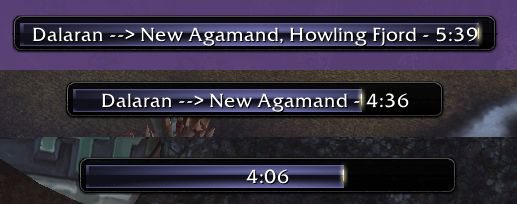

# OnFlight for WoW Forever

OnFlight is a simple taxi flight timer mod that lets you know how long it will take to get to where you are going.

Support Taxies started by Gossip Options (and in game editor to add more as needed/desired)
Learns New Flight times or updates existing flight times as they are taken.
Flight times added to tooltip on flight map. (Comes with Horde Side flight times for Northrend, Outland, Azeroth for most flights)
Flight Destinations Window: When the Flight Master Window is open (Taxi Map) it will also show a new window that has all the destinations listed out by zone with easy to click btutons to get to where your going. Some zones are overy crowded and hard to click to get the right one.
LibSharedMedia Support for Bar Textures & Borders.

## Controls

- `/onflight` opens settings outside combat.
- Control-click and drag the timer to move it.
- Shift-click the timer to insert the remaining time into chat.
- Shift-click a destination in the companion window to toggle its favorite status.
- The taxi-map button toggles the destination window with left-click and settings with right-click.

You can disable either display module in settings. Flight tracking continues while the timer display is disabled. Enable “Show Gossip Config” to edit the gossip options that start tracked flights.

## Bugreports
Report bugs through [GitHub issues](https://github.com/orionshock/OnFlight/issues), including your client build, route, and any Lua error.
